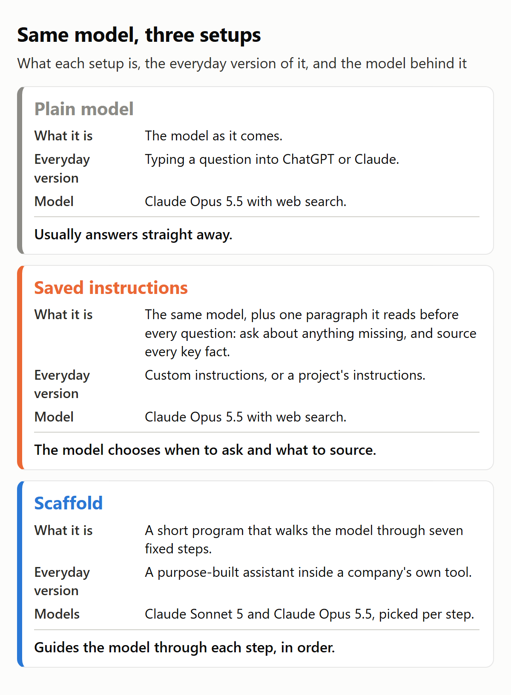
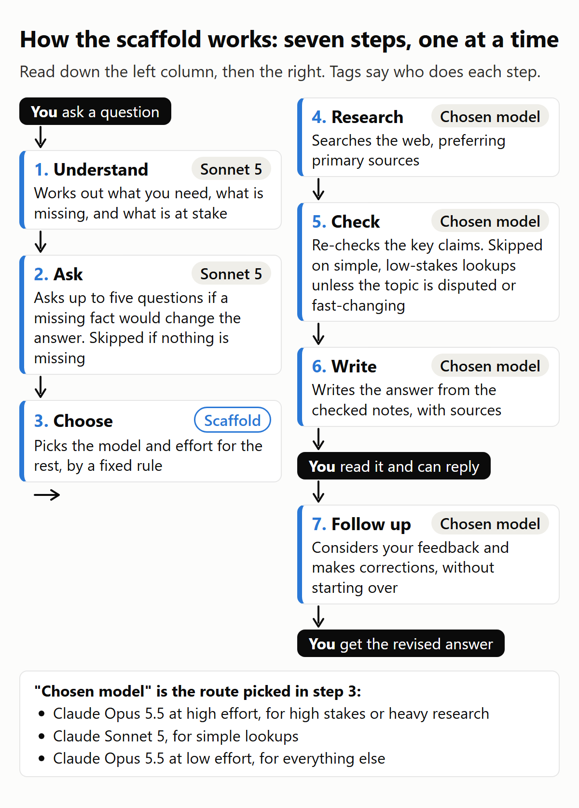
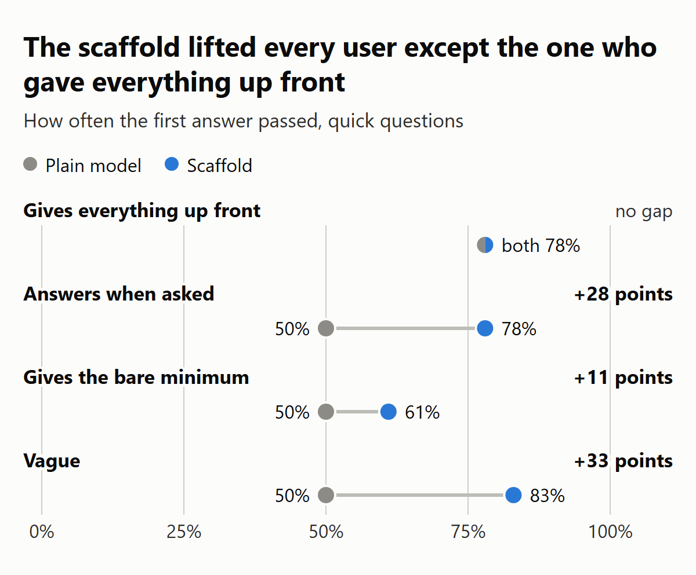
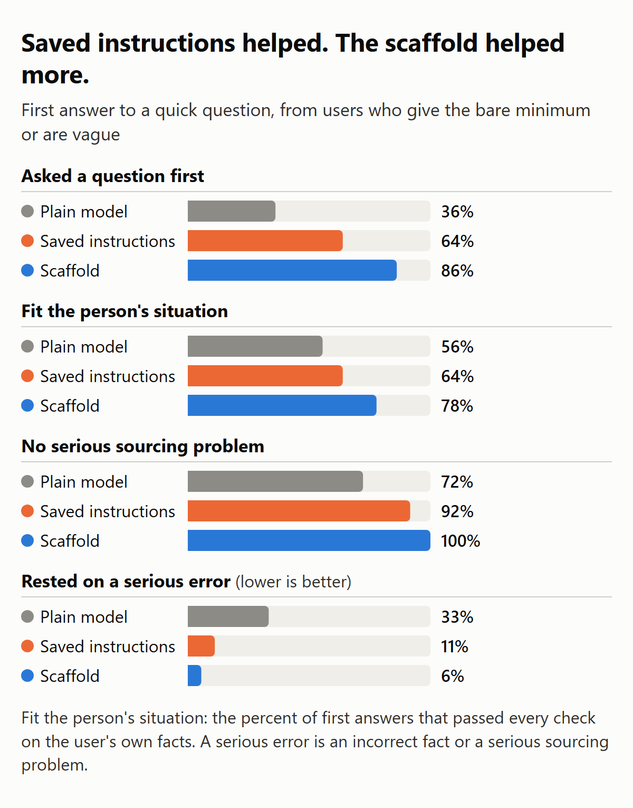
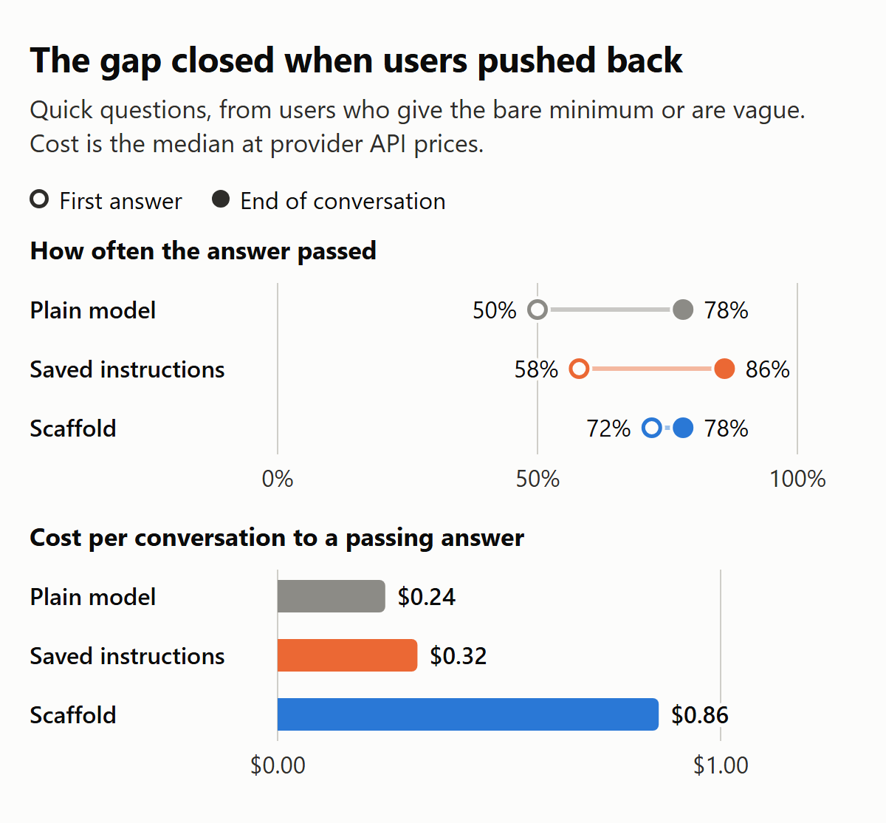

# Results

This page gives every number the article states, with the count behind each percentage and what it was counted out of. The tables follow the article's order. The last part gives the study's fixed measures for every conversation in the run.

## How to read these numbers

**What a pass is.** An answer passes when it meets every check on its question's checklist and clears four yes-or-no questions. It must do the job the user needed, respect the facts the user gave, contain no serious accuracy error, and contain no serious sourcing problem. A reply that only asks the user a question is not an answer, so it is not graded as one. [How it was graded](how-it-was-graded.md) gives the full rules.

**First answer and end of conversation.** The first answer is the first reply in a conversation that is an answer. It is what you get if you take the answer at face value. The end of the conversation counts as a pass when any answer in the conversation passed. Later answers get a chance because the simulated user kept pushing back until it was satisfied or the conversation stopped. The simulated users are described in [Simulated users](simulated-users.md).

**Why some tables cover two users and others four.** Saved instructions ran only with two simulated users: the one who gives the bare minimum and the vague one. So every table that compares all three setups uses only those two users, 36 conversations per setup. Tables that compare the plain model with the scaffold alone use all four users, 72 conversations per setup on the quick questions.

**How cost is counted.** Costs are provider API list prices in US dollars. The providers charge per token, plus a small fee for each web search. Cost per good answer is the median cost of a conversation up to its first passing answer. A conversation that never passed counts at its full cost. Costs cover first runs only, not the repeats.

**Percentages.** Each percentage is the count divided by the total, rounded to a whole number.

## What was run

The study used 27 questions. Six were quick questions only, nine were detailed requests only, and twelve were written both ways. That made 18 quick questions and 21 detailed requests, 39 tasks in all. A quick question is one short line. A detailed request spells out the situation, the limits and the form of the answer.

*Figure 1. The last line on each card is what sets that setup apart.*

*Figure 2. Step 2 is skipped when nothing is missing, and step 5 on simple, low-stakes lookups unless the topic is contested or changes fast.*

Conversations per setup and simulated user:

| Setup | Gives everything up front | Answers when asked | Gives the bare minimum | Vague | First runs | Repeats |
|---|---|---|---|---|---|---|
| Plain model | 18 | 18 quick, 21 detailed | 18 | 18 | 93 | 30 |
| Saved instructions | none | none | 18 | 18 | 36 | none |
| Scaffold | 18 | 18 quick, 21 detailed | 18 | 18 | 93 | 30 |

That makes 222 first runs and 60 repeats, 282 conversations in all. Detailed requests ran with the user who answers when asked. The 60 repeats cover 12 questions drawn at random before the run.

## First answer by user

Quick questions, plain model against scaffold, all four simulated users.

*Figure 3. The gap between the grey and blue dots is the scaffold's lead for that user.*

| Simulated user | Plain model | Scaffold |
|---|---|---|
| Gives everything up front | 78% (14 of 18) | 78% (14 of 18) |
| Answers when asked | 50% (9 of 18) | 78% (14 of 18) |
| Gives the bare minimum | 50% (9 of 18) | 61% (11 of 18) |
| Vague | 50% (9 of 18) | 83% (15 of 18) |
| All four users | 57% (41 of 72) | 75% (54 of 72) |

## The three setups on the two shared users

First answers to quick questions, from the user who gives the bare minimum and the vague user, 36 conversations per setup.

*Figure 4. On every measure, saved instructions land between the plain model and the scaffold.*

| Measure | Plain model | Saved instructions | Scaffold |
|---|---|---|---|
| Asked a question first | 36% (13 of 36) | 64% (23 of 36) | 86% (31 of 36) |
| Fit the person's situation | 56% (20 of 36) | 64% (23 of 36) | 78% (28 of 36) |
| No serious sourcing problem | 72% (26 of 36) | 92% (33 of 36) | 100% (36 of 36) |
| Rested on a serious error | 33% (12 of 36) | 11% (4 of 36) | 6% (2 of 36) |

How each measure is counted:

- **Asked a question first.** Conversations whose first answer came after the model asked the user a question, with no correction from the user before it.
- **Fit the person's situation.** First answers that met every check about the person's own facts, such as "the laptop must be $800 or less". Every one of these conversations had at least one such check.
- **No serious sourcing problem.** First answers with no key claim resting on a source that does not back it up, on no source where one is needed, or on a source with a clear conflict of interest, such as an affiliate link.
- **Rested on a serious error.** First answers that failed because of a serious accuracy error or a serious sourcing problem. A serious accuracy error is an incorrect fact the user would rely on and act wrongly on. Lower is better.

The first answer passed for each of the two users as follows:

| Simulated user | Plain model | Saved instructions | Scaffold |
|---|---|---|---|
| Gives the bare minimum | 50% (9 of 18) | 67% (12 of 18) | 61% (11 of 18) |
| Vague | 50% (9 of 18) | 50% (9 of 18) | 83% (15 of 18) |

## End of conversation and cost

The same two users and the same 36 quick-question conversations per setup.

*Figure 5. By the end of the conversation the plain model had caught up, at less than a third of the scaffold's cost.*

| Measure | Plain model | Saved instructions | Scaffold |
|---|---|---|---|
| First answer passed | 50% (18 of 36) | 58% (21 of 36) | 72% (26 of 36) |
| End of conversation passed | 78% (28 of 36) | 86% (31 of 36) | 78% (28 of 36) |
| Cost per good answer | $0.24 | $0.32 | $0.86 |

Saved instructions cost about 7 cents more per good answer than the plain model. The scaffold cost about 3.5 times as much per good answer as the plain model.

## Quick questions against detailed requests

The 12 questions written both ways, each asked once as a quick question and once as a detailed request, with the user who answers when asked on both sides. Twelve conversations per cell give wide ranges. The plausible range is the 95% Wilson score interval, a standard way to put a range around a share from a small count.

| Setup | Quick question, first answer passed | Plausible range | Detailed request, first answer passed | Plausible range |
|---|---|---|---|---|
| Plain model | 50% (6 of 12) | 25.38% to 74.62% | 75% (9 of 12) | 46.77% to 91.11% |
| Scaffold | 67% (8 of 12) | 39.06% to 86.19% | 50% (6 of 12) | 25.38% to 74.62% |

Across all 21 detailed requests, the plain model's first answer passed 76% (16 of 21) and the scaffold's 52% (11 of 21).

## Repeats

Twelve questions, drawn at random before the run, were run a second time with the same setup and simulated user. That gave 30 repeated slots per setup and 60 repeat conversations in all. A slot is one question asked by one simulated user.

| Measure | Plain model | Scaffold |
|---|---|---|
| First answer flipped between pass and fail across the two runs | 4 of 30 | 7 of 30 |
| Both runs reached a good answer | 63% (19 of 30) | 70% (21 of 30) |
| Exactly one run reached a good answer | 30% (9 of 30) | 23% (7 of 30) |

The first answer flipped 11 times in all, 7 of them for the scaffold.

## Blocked pages

187 of 486 answers (38%) said a page could not be read. That count is a text search of the answers, because the run records do not log blocked pages. The table covers the plain model and the scaffold on all four users and both formats, and saved instructions on its two users and quick questions.

| Setup | Answers that said a page could not be read | Pages read per answer |
|---|---|---|
| Plain model | 22% (45 of 200) | 3.5 |
| Saved instructions | 32% (23 of 72) | 3.8 |
| Scaffold | 56% (119 of 214) | 11.0 |

The scaffold read about three times as many pages per answer, so it met more blocked pages.

Seventeen questions had half or more of their answers say a page would not load: D-B-02, D-B-09, D-F-02, D-F-06, D-F-26, F-F-05, F-F-21, F-F-23, F-F-24, U-B-12, U-F-01, U-F-03, U-F-04, U-F-10, U-F-12, U-F-24 and U-F-25. Setting them aside barely changed the results. Same basis as the table above:

| First answer passed | Plain model | Saved instructions | Scaffold |
|---|---|---|---|
| All questions | 61% (57 of 93) | 58% (21 of 36) | 70% (65 of 93) |
| With the 17 questions set aside | 60% (40 of 67) | 60% (18 of 30) | 70% (47 of 67) |

The laptop question was hit hardest. 22 of its 41 quick-question answers and all 5 of its detailed answers said a page would not load. Only 12 of the 81 laptop answers passed, repeats included.

## The chance check

On quick questions across all four users, the plain model's first answer passed 41 of 72 and the scaffold's 54 of 72, a gap of 18 points. Three tests asked how often a gap that size would turn up if the scaffold made no difference. The article reports it as about 3 times in 100.

| Test | What it does | Result |
|---|---|---|
| Two-group test | Treats the two sets of 72 as independent | p = 0.020 |
| Matched-pair test (McNemar) | Pairs the same question and user across the two setups: 23 pairs where only the scaffold passed, 10 where only the plain model passed | p = 0.035 |
| Question bootstrap | Resamples the 18 questions, keeping each question's four users together | Gap range about −1 to 36 points; no gap or a reversed one in 3.9% of resamples |

The gap is likely real, but its size is uncertain. The bootstrap range runs from about zero to 36 points, so 18 points should not be read as exact.

## Recovery after a failed first answer

Quick questions. A correction is a user turn that names a fact the answer broke. "Added facts" means the user added facts or answered the model's questions.

| Setup and users | First answers failed | Later reached a good answer | After a correction | After added facts | Never reached a good answer |
|---|---|---|---|---|---|
| Plain model, two shared users | 18 | 10 | 6 | 4 | 8 |
| Saved instructions, two shared users | 15 | 10 | 8 | 2 | 5 |
| Scaffold, two shared users | 10 | 2 | 2 | 0 | 8 |
| Plain model, all four users | 31 | 17 | 8 | 9 | 14 |

On the same quick questions from the two shared users, the plain model drew 38 corrections in 36 conversations, saved instructions 31 in 36, and the scaffold 49 in 36.

## The melanoma question

The question about a father's stage III melanoma ran in 14 conversations across all three setups, repeats included. All 21 of its answers passed.

## The blind check

The author graded 19 answers blind, without knowing which setup wrote them. The author passed all 19, including eight that the final grades failed: four from the plain model, three from the scaffold and one from saved instructions. On those 19, the author's grade matched the grader's on 10 and the final grade on 11. So the author was more lenient than the final grades, but not kinder to the scaffold.

## Fixed measures for the whole run

These are the study's measures over every first run. Unless a table says otherwise, the plain model and the scaffold cover all four users and both formats, 93 conversations each. Saved instructions cover its two users on quick questions, 36 conversations.

**Totals.** 282 conversations: 222 first runs and 60 repeats. 811 replies were graded, of which 619 were answers. 61% of answers passed (380 of 619), repeats included.

### Reaching a good answer

A conversation reached a good answer when at least one of its answers passed.

| Measure | Plain model | Saved instructions | Scaffold |
|---|---|---|---|
| Conversations that reached a good answer | 82% (76 of 93) | 86% (31 of 36) | 83% (77 of 93) |
| Median replies to the first passing answer, conversations that reached one | 1 (76 conversations) | 2 (31) | 2 (77) |
| Answers that passed | 56% (112 of 200) | 61% (44 of 72) | 69% (147 of 214) |

**Conversations that reached a good answer, by simulated user.** Quick questions only, because detailed requests ran with one user.

| Simulated user | Plain model | Saved instructions | Scaffold |
|---|---|---|---|
| Gives everything up front | 83% (15 of 18) | did not run | 89% (16 of 18) |
| Answers when asked | 83% (15 of 18) | did not run | 94% (17 of 18) |
| Gives the bare minimum | 78% (14 of 18) | 89% (16 of 18) | 67% (12 of 18) |
| Vague | 78% (14 of 18) | 83% (15 of 18) | 89% (16 of 18) |

**Answers that passed, by simulated user.** Quick questions only, every answer in the conversation.

| Simulated user | Plain model | Saved instructions | Scaffold |
|---|---|---|---|
| Gives everything up front | 50% (17 of 34) | did not run | 74% (35 of 47) |
| Answers when asked | 55% (22 of 40) | did not run | 81% (26 of 32) |
| Gives the bare minimum | 48% (21 of 44) | 59% (23 of 39) | 59% (26 of 44) |
| Vague | 51% (22 of 43) | 64% (21 of 33) | 71% (29 of 41) |

### Kinds of check

Every check on every answer, by its kind. A check on a limit the user never stated anywhere in the conversation is left out, because it does not decide pass or fail.

| Kind of check | Plain model | Saved instructions | Scaffold |
|---|---|---|---|
| Fits the person's situation | 69% (200 of 291) | 69% (72 of 104) | 85% (272 of 321) |
| Gets the facts right | 80% (218 of 272) | 93% (88 of 95) | 88% (247 of 282) |

### Asking first

Conversations whose first reply asked the user a question instead of answering, on quick questions. This count differs from "Asked a question first" above, which uses only the two shared users and excludes conversations with a correction before the first answer.

| Format | Plain model | Saved instructions | Scaffold |
|---|---|---|---|
| Quick questions | 25% (18 of 72) | 64% (23 of 36) | 79% (57 of 72) |

### Users who stopped too early

Sometimes the simulated user said it was satisfied though no answer in the conversation had passed. "Stopped without saying" counts conversations that stopped without the simulated user saying whether it was satisfied.

| Measure | Plain model | Saved instructions | Scaffold |
|---|---|---|---|
| Satisfied, but no answer passed (of conversations where the user said it was satisfied) | 14% (9 of 65) | 0% (0 of 20) | 16% (8 of 49) |
| Stopped without saying | 17% (16 of 93) | 17% (6 of 36) | 23% (21 of 93) |

### Corrections

A correction is a user turn that names a fact the reply broke.

| Measure | Plain model | Saved instructions | Scaffold |
|---|---|---|---|
| All conversations | 95 over 93 (1.0 each) | 31 over 36 (0.9 each) | 128 over 93 (1.4 each) |
| Before the first passing answer, conversations that reached one | 16 over 76 (0.2 each) | 10 over 31 (0.3 each) | 16 over 77 (0.2 each) |
| Conversations that never reached a good answer | 23 over 17 (1.4 each) | 8 over 5 (1.6 each) | 26 over 16 (1.6 each) |

### Cost

Provider API list prices in US dollars, first runs only. Cost per good answer counts a conversation that never passed at its full cost. Median cost per conversation counts every conversation at its full cost.

| Measure | Plain model | Saved instructions | Scaffold |
|---|---|---|---|
| Cost per good answer | $0.29 (93 conversations) | $0.32 (36) | $1.09 (93) |
| Median cost to the first passing answer, conversations that reached one | $0.28 (76) | $0.30 (31) | $1.06 (77) |
| Median cost per conversation | $0.42 (93) | $0.46 (36) | $1.23 (93) |
| Total cost | $59.53 (93 conversations) | $19.41 (36) | $180.18 (93) |
| Web searches, every reply | 736 | 255 | 1,641 |

**Questions both setups solved.** Slots (one question asked by one simulated user) where both this setup and the plain model reached a good answer, with each one's median cost to the first passing answer.

| Setup | Slots both solved | Median cost, this setup | Median cost, plain model |
|---|---|---|---|
| Saved instructions | 26 | $0.27 | $0.24 |
| Scaffold | 67 | $1.09 | $0.29 |

### Searching and sourcing

Per answer, from the run records. Distinct sites counts the different websites among an answer's links.

| Measure | Plain model | Saved instructions | Scaffold |
|---|---|---|---|
| Searches per answer | 3.6 (711 over 200) | 3.5 (255 over 72) | 7.6 (1,627 over 214) |
| Pages read per answer | 3.5 (710 over 200) | 3.8 (272 over 72) | 11.0 (2,354 over 214) |
| Distinct sites per answer | 17.3 (3,455 over 200) | 19.8 (1,422 over 72) | 28.4 (6,079 over 214) |
| No serious sourcing problem | 75% (150 of 200) | 94% (68 of 72) | 96% (206 of 214) |
| Answers with no sources | 17% (34 of 200) | 0% (0 of 72) | 14% (29 of 214) |
| No serious accuracy error, among answers with no sources | 76% (26 of 34) | none to count | 79% (23 of 29) |
